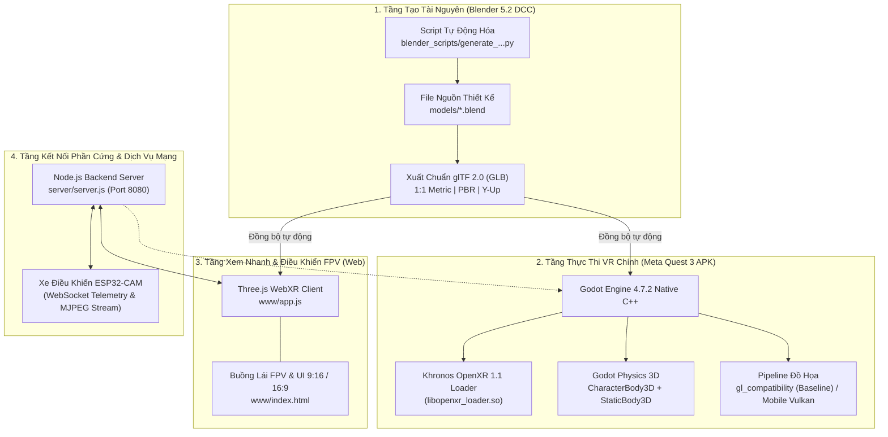

# KIẾN TRÚC KỸ THUẬT HỆ THỐNG TOÀN DIỆN (SYSTEM ARCHITECTURE SPECIFICATION)

**Dự án:** Autonomous VR City Simulator & Living Urban Twin  
**Phiên bản:** 2.1 (Kiến trúc Hợp nhất Sau Hardening)  
**Tác giả:** Principal Systems & VR Architect

---

## I. TỔNG QUAN KIẾN TRÚC ĐA TẦNG (MULTI-TIER ARCHITECTURE)

Hệ thống được tổ chức thành 4 phân tầng độc lập với ranh giới trách nhiệm (separation of concerns) rõ ràng:

---

## II. QUẢN LÝ DÒNG CHẢY DỮ LIỆU & GIAO THỨC TRUYỀN THÔNG (DATA FLOWS)

1. **Pipeline Asset 3D:**
   * `Blender 5.2` (Hệ trục $+Z$ Up) $\xrightarrow{\text{export\_yup=True}}$ `GLB` (Hệ trục $+Y$ Up, Forward $-Z$) $\xrightarrow{\text{Auto Import}}$ `Godot Engine 4.7.2` & `Three.js`.
   * Toàn bộ mesh geometry, UVs, và PBR parameters được bảo toàn tuyệt đối không suy hao.
2. **Kênh Điều Khiển Telemetry (IoT / RC Car):**
   * Người dùng thao tác vô lăng/cần số trên giao diện web hoặc controller VR $\to$ Đóng gói JSON telemetry $\to$ Gửi qua WebSocket tới `server.js` (Port 8080) $\to$ Chuyển tiếp tới vi điều khiển ESP32 trên xe mô hình.
3. **Kênh Hình Ảnh FPV Thời Gian Thực:**
   * Camera OV2640 trên ESP32 bắt hình ảnh $\to$ Bắn stream MJPEG qua HTTP/TCP $\to$ `server.js` phân phối tới màn hình buồng lái ảo trong không gian 3D.

---

## III. RANH GIỚI BẢO MẬT VÀ QUYỀN HẠN ANDROID (SECURITY & BOUNDARIES)

* **Nguyên tắc Đặc quyền Tối thiểu (Least Privilege):** 
  * APK chỉ yêu cầu quyền mạng `android.permission.INTERNET` để kết nối WebSocket cục bộ và quyền OpenXR (`org.khronos.openxr.permission.OPENXR`).
  * Tuyệt đối không yêu cầu các quyền nhạy cảm như đọc danh bạ, vị trí GPS, micro hoặc bộ nhớ ngoài của người dùng.
* **Môi trường Sandbox Android:**
  * File APK chạy trong sandbox tiêu chuẩn của Horizon OS. Cấu hình `application-debuggable` cho phép phân tích log qua `adb logcat` nhưng không mở cổng dịch vụ ra ngoài mạng công cộng.
