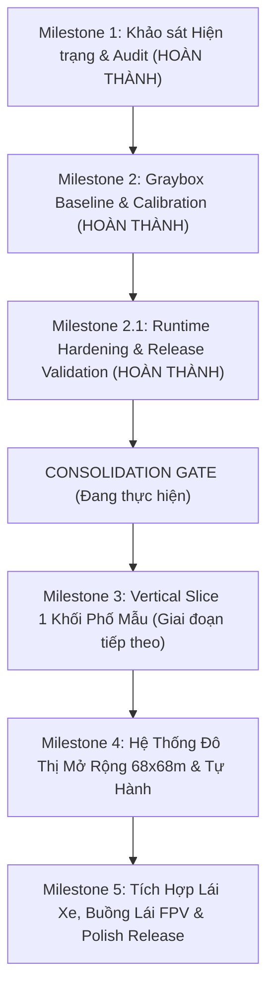

# LỘ TRÌNH PHÁT TRIỂN DỰ ÁN TOÀN DIỆN (PROJECT ROADMAP)

**Dự án:** Autonomous VR City Simulator & Living Urban Twin  
**Phiên bản kế hoạch:** 2.0 (Hậu Consolidation Gate)

---

## I. TỔNG QUAN TIẾN ĐỘ THEO CÁC MILESTONES

---

## II. CHI TIẾT CÁC GIAI ĐOẠN

### 1. Milestone Đã Hoàn Thành (Historical Milestones)
* **Milestone 1 (Reconnaissance & Initial Audit):**
  * Rà soát toàn bộ cấu trúc repo `D:\XE_RC_FPV_V10`.
  * Xác lập chiến lược bảo toàn 100% phân hệ RC FPV buồng lái.
* **Milestone 2 (Spatial Calibration & Graybox Baseline):**
  * Tạo cổng kiểm chuẩn 1:1 mét (`calibration_gate.blend`) và khối phố 32m (`graybox_city_block.blend`) qua Blender 5.2.
  * Xuất file GLB và đồng bộ sang Godot và Three.js.
  * Hiệu chỉnh phép tính khoảng hở Controller ($0{,}25\,\text{m}$).
* **Milestone 2.1 (Runtime Hardening & Release Validation):**
  * Thẩm định cấu trúc APK `XE_RC_FPV_V18.apk` bằng `aapt` và `apksigner`.
  * Kiểm chứng va chạm vật lý 5/5 bài test thành công trên Godot 4.7.2 Headless.
  * Thử nghiệm xuất thành công bản build Mobile Vulkan renderer (`XE_RC_FPV_V18_mobile.apk`).

---

### 2. Giai đoạn Tiếp theo: Milestone 3 — Vertical Slice 1 Khối Phố Mẫu
**Mục tiêu:** Xây dựng một lát cắt hoàn chỉnh (Vertical Slice) của 1 phân đoạn phố mẫu có đầy đủ hình khối, vật liệu PBR, cây xanh, xe cộ và người đi bộ tự hành.

* **Nhiệm vụ 3.1 (Architectural & Street Detailing):**
  * Hoàn thiện chi tiết mặt đứng Nhà phố Cafe (cửa kính, lam gỗ, biển hiệu LED, điều hòa).
  * Ốp vật liệu PBR cho mặt đường nhựa hạt mịn và đá lát vỉa hè chống trơn.
  * Lắp đặt trạm xe buýt và cây xanh đô thị hoàn chỉnh.
* **Nhiệm vụ 3.2 (Autonomous Urban Life Simulation):**
  * Lập trình 1 xe buýt/ô tô chạy tự động theo quỹ đạo làn đường trục $OX$.
  * Lập trình 2 NPC đi bộ tuần tra qua lại trên hành lang $2{,}0\,\text{m}$ vỉa hè, biết né tránh khi gặp người chơi hoặc chướng ngại vật.
  * Đặt 1 động vật nhỏ (chó/mèo) đi dạo trong thảm cỏ công viên.
* **Nhiệm vụ 3.3 (VR Pedestrian Controller in Godot):**
  * Tích hợp node `XROrigin3D`, `XRCamera3D`, và 2 node `XRController3D` trong Godot.
  * Thiết lập chuyển động đi bộ mượt mà (Smooth Locomotion) dựa trên hướng nhìn của HMD kết hợp cần gạt analog trái.
  * Khóa cứng hệ thống tracking 6-DoF tự nhiên của kính Meta Quest 3, không can thiệp độ cao mắt giả định.

---

### 3. Các Milestone Tương Lai (Future Horizons)
* **Milestone 4 (City Expansion & Full Autonomous Systems):**
  * Mở rộng mạng lưới đường phố thành ô bàn cờ $68\,\text{m} \times 68\,\text{m}$ có ngã tư giao lộ và đèn tín hiệu thông minh.
  * Tối ưu hóa occlusion culling, HLOD và GPU instancing để duy trì 90 FPS.
* **Milestone 5 (FPV Cockpit Bridge & Polish):**
  * Tích hợp luồng stream video trực tiếp từ xe RC vào màn hình tablet/buồng lái trong không gian VR.
  * Hỗ trợ chuyển đổi liền mạch giữa đi bộ ngoài phố và bước vào buồng lái xe FPV.
