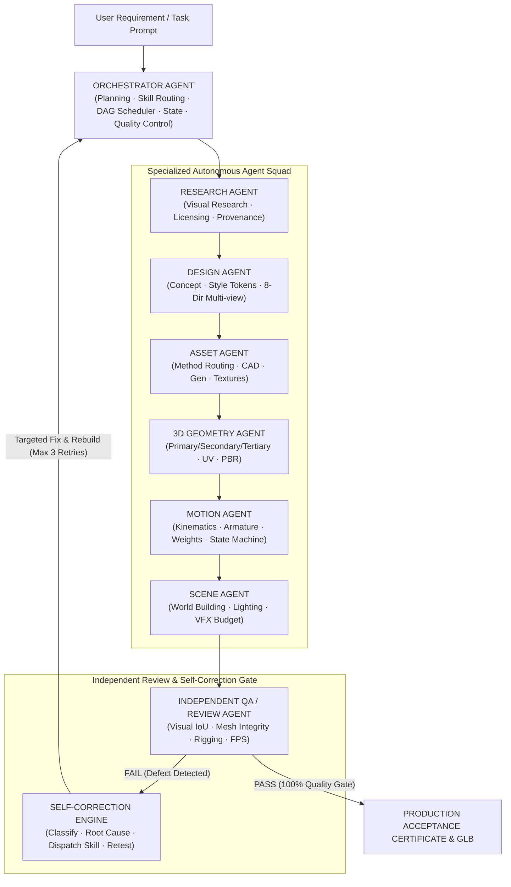
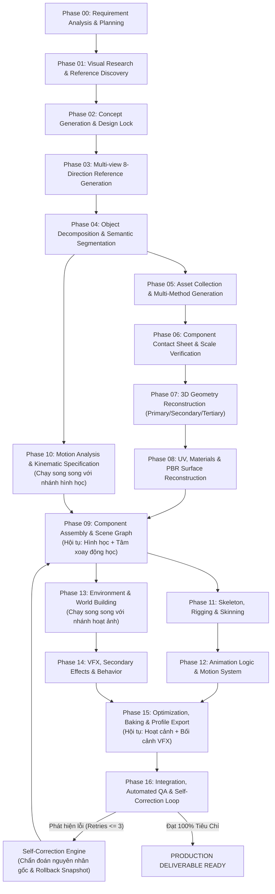

# MASTER AI 3D PRODUCTION PIPELINE SPECIFICATION (VERSION 2.1)
## Senior Technical Director Architecture, Execution Contracts & 17-Phase Master DAG Engine

**Target Capability Level:** 8.5/10 (Production-Grade Autonomous 3D Lifecycle)  
**Author:** Senior Technical Director & Systems Architecture Lead (AgentOS)  
**Scope:** Universal 3D Asset Production (10 Archetypes: Humanoid, Vehicle, Cockpit, Creature, Environment, Props, Mechanical Assemblies, etc.)  
**Target Deployments:** Meta Quest 3 WebXR (72Hz/80Hz/90Hz/120Hz), Three.js Realtime, Desktop Cinematic, Game Engines  

---

## 1. MỤC TIÊU & NGUYÊN TẮC CỐT LÕI (CORE PRINCIPLES)

1. **End-to-End Production Ownership (Từ Ý Niệm Đến Kiểm Định Thực Tế)**:
   - Hệ thống không chỉ dừng ở việc "viết code Blender procedural để tạo vài hình khối cơ bản".
   - AI Agent làm chủ toàn bộ chuỗi sản xuất: **Nghiên cứu thị giác & Bản quyền → Thiết kế Canonical → Phân rã ngữ nghĩa → Tạo hình đa phương pháp → Dựng hình 3 lớp (Primary/Secondary/Tertiary) → Khớp động học & Rigging → Hoạt ảnh đa tầng & State Machine → Bối cảnh & VFX → Xuất xưởng glTF 2.0 → Kiểm định độc lập & Tự sửa chữa (Self-Correction)**.
2. **Separation of Duties (Tách Biệt Vai Trò & Chống Tự Tuyên Bố Hoàn Hảo)**:
   - Nghiêm cấm mô hình "một agent vừa tạo mesh vừa tự khen mesh của mình đạt chuẩn".
   - Luôn luôn phân định rõ: **Agent Sản xuất (3D / Motion / Asset Agent)** tạo tài sản; **Independent QA / Review Agent** độc lập kiểm định dựa trên tiêu chí đo lường định lượng (IoU cùng góc camera, Delta E CIEDE2000, manifold, frame-time).
3. **Dependency-Aware 17-Phase Master DAG với Nhánh Xử Lý Song Song**:
   - Vận hành theo đồ thị có hướng không chu trình (DAG). Không chạy tuần tự cứng nhắc.
   - Các bộ phận độc lập được sản xuất song song:
     * *Phân nhánh 1*: Nghiên cứu động học (Phase 10) chạy song song với Tạo linh kiện & Dựng hình (Phases 05-08).
     * *Phân nhánh 2*: Dựng bối cảnh môi trường (Phases 13-14) chạy song song với Gắn xương & Hoạt ảnh (Phases 11-12).
   - Trạng thái và artifact trung gian được lưu bền vững tại `D:\AgentOS\Vault\production_3d_pipeline\<asset_id>\` và `D:\AgentOS\jobs\<asset_id>\checkpoint.json`. Khi gặp gián đoạn, agent tiếp tục đúng phase chưa hoàn thành, không chạy lại từ đầu.
4. **Token Discipline & Progressive Context Loading**:
   - Agent chỉ nạp thông tin skill liên quan trực tiếp đến phase đang chạy.
   - Giao tiếp giữa các Agent thông qua schema có cấu trúc (`.yaml`, `.json`), không đổ toàn bộ raw mesh vertex hay lịch sử hội thoại vào ngữ cảnh.

---

## 2. KIẾN TRÚC ĐA TÁC TỬ (MULTI-AGENT ORCHESTRATION TOPOLOGY)

---

## 3. SƠ ĐỒ ĐỒ THỊ 17-PHASE MASTER DAG (DEPENDENCY-AWARE CONCURRENT DAG)

Khác với chuỗi tuần tự trước đây, sơ đồ dưới đây thể hiện chính xác các nhánh thực thi song song và các điểm hội tụ (Convergence Points):

---

## 4. CHI TIẾT 17 PHASE SẢN XUẤT ĐẦU-CUỐI

### NHÓM A — RESEARCH & VISUAL INTELLIGENCE

#### Phase 00 — Requirement Analysis & Production Planning (Bắt buộc)
- **Nhiệm vụ:** Phân tích toàn diện 10 thuộc tính bắt buộc của sản phẩm trước khi can thiệp 3D:
  1. `Object type`: Humanoid Character, Mechanical Vehicle, Vehicle Interior / Cockpit, Creature, Modular Environment, Prop.
  2. `Purpose`: Meta Quest 3 WebXR, Realtime Game, Cinematic, Simulation.
  3. `Art style`: Realistic PBR, Stylized, Sci-fi industrial, Low-poly.
  4. `Scale`: Kích thước vật lý thực tế (mét) và tỷ lệ giải phẫu (ví dụ: $1:7.5$ cho người, $1:10$ cho xe RC).
  5. `Geometry scope`: Danh sách linh kiện, cấu trúc phân rã sơ bộ.
  6. `Materials`: Phân loại vật liệu theo từng bề mặt (da, vải, carbon, nhôm, kính, cao su).
  7. `Motion`: Các chuyển động bắt buộc (Idle, Walk, Wave, Steering, Throttle, Suspension).
  8. `Interaction`: Khả năng tương tác (cầm cần điều khiển, gạt cần ga, mở cửa, bấm nút buồng lái).
  9. `Target platform`: WebXR 72Hz/80Hz/90Hz/120Hz, Three.js, Blender source.
  10. `Quality acceptance`: Ngân sách tam giác, draw calls, dung lượng VRAM, sai số màu sắc.
- **Artifacts đầu ra:** `production_brief.yaml`, `asset_requirements.yaml`, `acceptance_criteria.yaml`, `production_plan.yaml`.

#### Phase 01 — Visual Research & Reference Discovery (Bắt buộc)
- **Nhiệm vụ:** Nghiên cứu chủ động tài liệu tham khảo theo 7 nhóm chuyên biệt:
  - *Silhouette*: Hình dáng tổng thể, tỷ lệ tương quan.
  - *Anatomy*: Cấu trúc xương, cơ bắp hoặc khung sườn buồng lái.
  - *Components*: Chi tiết các bộ phận chức năng độc lập (ghế ngồi, bảng điều khiển, cần ga, vô lăng).
  - *Materials*: Mẫu ảnh chụp thực tế bề mặt vi mô (da, vải dệt, nhôm xước, kính trong suốt).
  - *Mechanical*: Bản lề, trục quay, cần gạt 1 DOF, khớp cầu joystick 3 DOF.
  - *Surface*: Đường may, nếp nhăn vải, đinh tán, rãnh xẻ, decal.
  - *Animation & Pose*: Tư thế ngồi lái, chu kỳ bước đi, góc với tay điều khiển.
- **Asset Provenance & License Guard:** Kiểm tra giấy phép (CC0, CC BY 4.0, Editorial, Proprietary). Phân biệt rạch ròi giữa *ảnh tham khảo hình dáng* và *asset được phép đóng gói vào game*.
- **Artifacts đầu ra:** `source_registry.json`, `license_manifest.json`, `reference_analysis.md`, `missing_information.md`.

#### Phase 02 — Concept Generation & Design Lock (Bắt buộc)
- **Nhiệm vụ:** Tổng hợp tài liệu tham khảo, chốt thiết kế chuẩn duy nhất (*Canonical Design Lock*).
  - Khóa silhouette nhận diện mạnh nhất và bảng màu (*Style Tokens & Color Palette*).
  - **Design Lock Invariant:** Sau khi chốt thiết kế, cấm tự ý làm biến dạng hoặc thay đổi phong cách giữa các góc nhìn hoặc giữa các bộ phận.
- **Artifacts đầu ra:** `design_bible.md`, `style_tokens.json`, `canonical_design.png`, `material_palette.json`.

#### Phase 03 — Multi-view Reference Generation (Gate 8 Góc Nhìn Chuẩn Mực)
- **Nhiệm vụ:** Tạo bộ 8 góc nhìn trực giao và phối cảnh chuẩn xác từ hệ thống quang học [`canonical_camera_rig.json`](file:///D:/AgentOS/workspaces/asset-engineering/adapters/production_3d_pipeline/canonical_camera_rig.json) (tiêu cự 50mm, khoảng cách 3.2m):
  1. `CAM_01_FRONT` ($0^\circ$): Tỷ lệ chiều rộng, cấu trúc mặt trước.
  2. `CAM_02_FRONT_LEFT_45` ($45^\circ$): Khối lượng và chiều sâu bên trái.
  3. `CAM_03_LEFT` ($90^\circ$): Độ sâu thân, độ cong cột sống/bảng điều khiển.
  4. `CAM_04_REAR_LEFT_45` ($135^\circ$): Giao điểm lưng và cánh tay/ghế ngồi.
  5. `CAM_05_BACK` ($180^\circ$): Cấu trúc lưng, bả vai, vách sau buồng lái.
  6. `CAM_06_REAR_RIGHT_45` ($225^\circ$).
  7. `CAM_07_RIGHT` ($270^\circ$).
  8. `CAM_08_FRONT_RIGHT_45` ($315^\circ$).
- **Quy Tắc Đo Lường Định Lượng Nghiêm Ngặt:**
  - *Silhouette IoU*: Chỉ đo lường giữa mặt nạ hình bóng kết xuất và hình tham khảo **ở cùng chỉ số camera đã hiệu chuẩn**. Tuyệt đối cấm so IoU giữa các góc khác nhau (ví dụ: cấm lấy Front so với Side).
  - *Ngưỡng nghiệm thu*: $\text{Silhouette IoU} \ge 0.85$, sai số điểm đặc trưng $\le 2.5\%$, sai số màu $\Delta E_{00} \le 5.0$.
- **Artifacts đầu ra:** `multiview_sheet_8dir.png`, `multiview_consistency_report.json`.

---

### NHÓM B — COMPONENT INTELLIGENCE & ASSET PRODUCTION

#### Phase 04 — Object Decomposition & Semantic Segmentation (Gate phân rã)
- **Nhiệm vụ:** Phân tách sản phẩm thành cây phân cấp ngữ nghĩa (*Semantic Component Tree*).
- **Metadata Bắt Buộc trên từng Component:**
  - `component_id`: Mã định danh duy nhất (ví dụ: `COCKPIT_CHAIR_L`, `THROTTLE_LEVER`, `ARM_L_FOREARM`).
  - `parent_id`: Node cha trong cây phân cấp.
  - `geometry_type`: Phân loại hình học (`organic_mesh`, `hard_surface`, `cad_procedural`, `cloth`).
  - `material_id`: Vật liệu PBR liên kết.
  - `pivot_local_m`: Tọa độ tâm xoay/khớp cục bộ (mét).
  - `motion_type`: Chuyển động (`rotation`, `translation`, `skinned_bone`, `static`).
  - `motion_axis` & `motion_limits`: Trục và giới hạn góc quay/tịnh tiến.
  - `lod_levels`: Danh sách cấp độ chi tiết (`LOD0`, `LOD1`, `LOD2`).
- **Artifacts đầu ra:** `component_hierarchy.json`, `component_metadata.yaml`.

#### Phase 05 — Asset Collection & Multi-Method Generation
- **Nhiệm vụ:** Định tuyến phương pháp sản xuất tối ưu theo từng loại linh kiện:
  - *Nhân vật hữu cơ, mặt, bàn tay*: Sculpting, quad-flow BMesh, retopology.
  - *Cơ cấu cơ khí, khung gầm, cần gạt*: Tham số CAD (Python `build123d`), procedural modeling.
  - *Trang bị bảo hộ, bảng điều khiển, ghế lái*: Hard-surface modeling với Bevel modifier.
  - *Vải vóc, trang phục bay*: Quad surface modeling, cloth draping simulation.
  - *Vật liệu & Texture*: Procedural ORM generator, PBR map generation.
- **Artifacts đầu ra:** `raw_components_manifest.json`.

#### Phase 06 — Component Contact Sheet & Scale Verification
- **Nhiệm vụ:** Quản lý bảng tổng hợp linh kiện và phân biệt rạch ròi 6 loại tài nguyên:
  1. *8-View Sheet*: Tham khảo nhiều góc tái tạo hình khối 3D ban đầu.
  2. *Component Contact Sheet*: So sánh tỷ lệ và socket lắp ghép giữa các linh kiện trước khi ráp.
  3. *Exploded View*: Sơ đồ bóc tách kiểm tra cấu trúc liên kết bên trong.
  4. *Texture Atlas*: Gộp texture cho nhiều mesh tối ưu draw call.
  5. *3D Scene Graph*: Cấu trúc phân cấp đối tượng 3D thực tế.
  6. *Sprite Sheet*: Hoạt ảnh frame 2D được kết xuất *sau khi đã hoàn thành animation 3D* (chỉ sinh khi có yêu cầu xuất game 2D).
- **Artifacts đầu ra:** `component_contact_sheet.png`, `component_scale_alignment.json`.

---

### NHÓM C — BLENDER GEOMETRY, ASSEMBLY & MATERIAL PRODUCTION

#### Phase 07 — 3D Geometry Reconstruction (Nguyên Tắc 3 Lớp Chi Tiết)
- **Nhiệm vụ:** Dựng hình 3D tuân thủ quy tắc phân tầng hình khối:
  - **Lớp 1 (Primary Forms)**: Khối lượng chính, tỷ lệ, hình bóng silhouette tổng thể. *Bắt buộc PASS mới được làm tiếp*.
  - **Lớp 2 (Secondary Forms)**: Nhóm cơ bắp, mảng giáp, đường cong cơ thể, gờ mép lắp ghép, vát cạnh (bevels).
  - **Lớp 3 (Tertiary Details)**: Đinh ốc, đường chỉ may, vết trầy xước, lỗ thoáng khí, vân sợi.
- **Topology & Mesh Integrity Invariants:**
  - Lưới khép kín (*Manifold geometry*) trên các khối thể tích đặc.
  - Tôn trọng các mặt phẳng hở có chủ đích (*Intentional Open Surfaces*) như vạt áo, tóc dạng thẻ (hair cards), kính vòm canopy mà không xóa nhầm.
  - Pháp tuyến mặt hướng ra ngoài đồng nhất; không có mặt nội tại ẩn bên trong thể tích.
- **Artifacts đầu ra:** `component_meshes.blend`, `geometry_validation_report.json`.

#### Phase 08 — UV, Materials & Surface Reconstruction
- **Nhiệm vụ:** Trải UV và thiết lập vật liệu PBR theo chuẩn Khronos glTF 2.0:
  - Trải UV không chồng lấn; mật độ điểm ảnh đồng đều ($800 - 1200\text{ px/m}$).
  - Đóng gói ORM chuẩn mực:
    * **Red (R)**: Ambient Occlusion (tương phản bóng nếp gấp và rãnh sâu).
    * **Green (G)**: Roughness (độ nhám vi mô của vật liệu).
    * **Blue (B)**: Metallic (kim loại $= 1.0$, điện môi da/vải $= 0.0000$ tuyệt đối).
  - Nối socket `Occlusion` qua node group `glTF Material Output` đảm bảo `metallicRoughnessTexture.index == occlusionTexture.index`.
- **Artifacts đầu ra:** `textured_components.blend`, `uv_texel_density_report.json`.

#### Phase 09 — Component Assembly & Scene Graph (Điểm Hội Tụ 1)
- **Nhiệm vụ:** Điểm hội tụ giữa nhánh hình học (Phase 08) và nhánh đặc tả động học (Phase 10):
  - Khớp nối các socket cha-con đúng vị trí.
  - **Pivot Alignment Rule**: Tâm xoay (Origin/Pivot) của linh kiện phải nằm đúng trục quay vật lý (ví dụ: chốt bản lề cần ga, khớp cầu joystick), không được để mặc định ở tâm hộp bao (*Bounding Box Center*).
  - Đóng băng biến đổi (*Freeze Transforms*): Root node có scale $(1, 1, 1)$, rotation $(0, 0, 0)$.
- **Artifacts đầu ra:** `assembled_asset.blend`, `assembly_transform_audit.json`.

---

### NHÓM D — KINEMATICS, SKELETON & ANIMATION INTELLIGENCE

#### Phase 10 — Motion Analysis & Kinematic Specification (Chạy Song Song Với Nhóm B-C)
- **Nhiệm vụ:** Lập bảng đặc tả động học (*Kinematic Specification*) ngay sau khi phân rã linh kiện (Phase 04):
  - Phân loại khớp: Khớp bản lề (*Hinge* - 1 DOF), khớp cầu (*Ball-and-Socket* - 3 DOF), khớp tịnh tiến (*Prismatic* - 1 DOF), khớp quay liên tục (*Revolute* - 1 DOF).
  - Xác định hệ trục tọa độ cục bộ và giới hạn góc an toàn (ví dụ: cần ga xoay $0^\circ - 60^\circ$ quanh trục X cục bộ).
- **Artifacts đầu ra:** `kinematic_specification.yaml`.

#### Phase 11 — Skeleton, Rigging & Skinning
- **Nhiệm vụ:** Xây dựng khung xương và gán trọng số biến dạng:
  - Ngân sách xương: $\le 48$ bones (chuẩn tối ưu cho vi xử lý Meta Quest 3).
  - Gán trọng số mượt mà, giới hạn tối đa 4 ảnh hưởng trên mỗi đỉnh (`JOINTS_0`, `WEIGHTS_0`).
  - **Archetype-Aware Joint Deformation**:
    * Đối với khớp uốn sinh học (khuỷu tay, đầu gối): Cấu trúc 3 vòng lặp đồng tâm (*3-loop joint rings*) giữ thể tích khi gập $120^\circ$.
    * Đối với khớp cơ khí (cần ga, vô lăng): Sử dụng chốt quay cứng (*Rigid hierarchy rotation*), không gán trọng số mềm gây méo kim loại.
- **Artifacts đầu ra:** `rigged_asset.blend`, `rig_deformation_report.json`.

#### Phase 12 — Animation Logic & Motion System
- **Nhiệm vụ:** Xây dựng hệ thống chuyển động đa tầng và máy trạng thái hoạt ảnh:
  - **Lớp A (Primary Motion)**: Idle, Walk, Run, Cockpit seated posture.
  - **Lớp B (Secondary Motion)**: Nhịp thở lồng ngực, liếc mắt nhìn bảng đồng hồ, rung cần điều khiển.
  - **Lớp C (Interactive Motion)**: Đẩy cần ga tiến/lùi, lắc cần điều khiển bay, bật công tắc trần.
  - **Lớp D (Procedural Motion)**: Giảm chấn đàn hồi theo gia tốc G-force buồng lái.
  - **Animation State Machine**: Chuyển đổi mượt mà giữa các trạng thái với thời gian hòa trộn xác định.
  - **Quaternion Continuity Rule**: Tự động áp dụng tích vô hướng ($q_1 \cdot q_2 < 0 \rightarrow -q_2$) để triệt tiêu hiện tượng xoay vặn $360^\circ$ tức thời.
- **Artifacts đầu ra:** `animated_asset.blend`, `animation_state_machine.json`.

---

### NHÓM E — ENVIRONMENT, EFFECTS & FINAL PRODUCTION

#### Phase 13 — Environment & World Building (Chạy Song Song Với Nhóm D)
- **Nhiệm vụ:** Dựng bối cảnh tương tác buồng lái hoặc xưởng bảo dưỡng:
  - Phân biệt rõ rệt hai môi trường chiếu sáng:
    * `LOOKDEV_STUDIO`: Chiếu sáng trung tính 3 điểm (Key, Fill, Rim) để kiểm tra chuẩn hóa vật liệu và hình dáng.
    * `PRODUCTION_ENVIRONMENT`: Chiếu sáng buồng lái thực tế (đèn neon xanh HUD, ánh sáng sao bên ngoài vòm kính, đèn cảnh báo).
  - Thiết lập sàn buồng lái, ghế ngồi, trần kính và vỏ ngoài.
- **Artifacts đầu ra:** `staged_scene.blend`, `environment_lighting_manifest.json`.

#### Phase 14 — VFX, Secondary Effects & Object Behavior
- **Nhiệm vụ:** Thêm hiệu ứng hình ảnh có kiểm soát fillrate cho GPU di động:
  - Màn hình HUD buồng lái phát sáng tự thân (*Emissive PBR*).
  - Độ bóng phản chiếu vòm kính canopy.
  - **XR Safe Overdraw Budget**: Giới hạn tối đa 2 lớp pass trong suốt, số lượng hạt bụi buồng lái $\le 128$ particles.
- **Artifacts đầu ra:** `vfx_manifest.json`, `particle_budget_audit.json`.

#### Phase 15 — Optimization, Baking & Profile Export (Điểm Hội Tụ 2)
- **Nhiệm vụ:** Hội tụ giữa nhánh hoạt ảnh (Phase 12) và nhánh bối cảnh VFX (Phase 14):
  - Áp dụng cấu hình phần cứng đo lường được theo bảng dưới.
  - Hỗ trợ chuẩn nén `KHR_texture_basisu` với fallback giải mã an toàn.
  - Xuất file nhị phân glTF 2.0 (`.glb`) tuân thủ nghiêm ngặt hệ trục $+Y\text{ Up}, +Z\text{ Forward}$, kèm đầy đủ animations, skins, và morph targets.
- **Artifacts đầu ra:** `production_deliverable.glb`, `gltf_export_manifest.json`.

#### Phase 16 — Integration, Automated QA & Self-Correction Loop (Final Acceptance)
- **Nhiệm vụ:** Vòng kiểm định độc lập 7 chiều và cơ chế tự động sửa sai có snapshot & giới hạn retry:
  1. *Visual QA*: Đối sánh silhouette IoU $\ge 0.85$ cùng góc camera, màu sắc CIEDE2000 $\Delta E \le 5.0$.
  2. *Geometry QA*: Manifold, không đảo pháp tuyến, ngân sách tam giác hợp lệ.
  3. *Rigging QA*: Số xương $\le 48$, max 4 trọng số/đỉnh, không xẹp khớp khi uốn gập.
  4. *Animation QA*: Chu kỳ lặp mượt mà, chuyển động quay đơn điệu không giật góc.
  5. *Material QA*: Khronos ORM binding hoàn chỉnh (`mr_tex == occ_tex`).
  6. *Export QA*: Đạt chuẩn Khronos glTF-Validator không cảnh báo lỗi nghiêm trọng.
  7. *Runtime QA*: Chạy kiểm định headless [xr-doctor.js](file:///d:/XE_RC_FPV_V10/tools/xr-doctor.js) đạt 100% Runtime Integrity.
- **Cơ chế Rollback & Giới Hạn Retry**:
  $$\text{Lưu snapshot trước khi sửa} \longrightarrow \text{Chẩn đoán} \longrightarrow \text{Áp dụng bản vá} \longrightarrow \text{Kiểm tra hồi quy}$$
  Nếu sau 3 lần retry vẫn không đạt hoặc xuất hiện hồi quy (*regression*), hệ thống rollback về snapshot an toàn và phát tín hiệu cảnh báo đến Technical Director.
- **Artifacts đầu ra:** `qa_audit_report.json`, `self_correction_log.json`, `final_acceptance_certificate.json`.

---

## 5. PROFILE PHẦN CỨNG META QUEST 3 THEO PHÉP ĐO THỰC TẾ

Không sử dụng các con số cứng nhắc, hệ thống phân chia rõ ràng giữa ngân sách **Từng Asset Đơn Lẻ (Per-Asset)** và **Toàn Bộ Scene (Full-Scene)** theo 4 mức tần số quét của Meta Quest 3:

| Tần Số Quét | Frame Budget Lý Thuyết | Ngưỡng Mục Tiêu (Headroom) | Ngân Sách Per-Asset (Avatar) | Ngân Sách Per-Asset (Cockpit) | Ngân Sách Full-Scene (Tổng Thể) | Max Draw Calls (Scene) | Max VRAM (Scene) |
| :---: | :---: | :---: | :---: | :---: | :---: | :---: | :---: |
| **72 Hz** | 13.89 ms | **13.70 ms** | 25,000 tris / 48 bones | 15,000 tris | 50,000 tris | 12 batches | 96 MB |
| **80 Hz** | 12.50 ms | **12.20 ms** | 22,000 tris / 48 bones | 13,000 tris | 45,000 tris | 10 batches | 80 MB |
| **90 Hz** | 11.11 ms | **10.90 ms** | 18,000 tris / 40 bones | 10,000 tris | 38,000 tris | 8 batches | 64 MB |
| **120 Hz** | 8.33 ms | **8.10 ms** | 12,000 tris / 32 bones | 8,000 tris | 25,000 tris | 6 batches | 48 MB |

---

## 6. MA TRẬN ĐÁNH GIÁ CHẤT LƯỢNG SENIOR TD 3 TẦNG (NO-SUBSTITUTION RULE)

Để đạt chứng nhận **8.5/10**, hệ thống bắt buộc vượt qua cả 3 tầng đánh giá:

1. **Tầng 1 — Critical Gates (Bắt buộc $\ge 8.0/10$ trên tất cả 7 năng lực cốt lõi)**:
   - `Research & Reference Intelligence` (Trọng số 10%)
   - `Concept & Multi-view Consistency` (Trọng số 12%)
   - `Geometry & Modeling` (Trọng số 15%)
   - `Kinematics & Rigging` (Trọng số 10%)
   - `Animation Intelligence` (Trọng số 10%)
   - `Optimization & Integration` (Trọng số 5%)
   - `Independent QA & Self-Correction` (Trọng số 5%)
2. **Tầng 2 — Supporting Capabilities (Bắt buộc $\ge 7.0/10$ trên tất cả 5 năng lực hỗ trợ)**:
   - `Component Decomposition` (Trọng số 8%)
   - `Asset Sourcing & Generation` (Trọng số 8%)
   - `UV & Material Production` (Trọng số 7%)
   - `Assembly & Scene Graph` (Trọng số 5%)
   - `Environment & VFX` (Trọng số 5%)
3. **Tầng 3 — Aggregate Score**: Tổng điểm trọng số đạt $\ge 8.5/10$.

> [!CAUTION]
> **Quy Tắc Chế Tài Nghiêm Ngặt:**  
> Bất kỳ năng lực cốt lõi nào $< 8.0/10$ sẽ lập tức bị gắn nhãn:  
> $$\mathbf{REJECTED\_CRITICAL\_GATE\_DEFICIT}$$  
> Bất kỳ năng lực hỗ trợ nào $< 7.0/10$ sẽ bị gắn nhãn:  
> $$\mathbf{REJECTED\_SUPPORTING\_CAPABILITY\_DEFICIT}$$  
> Điểm số chỉ được công nhận dựa trên sản phẩm thực tế $S_i = f(\text{Artifact}, \text{Validation}, \text{Reproducibility})$, tuyệt đối không tính điểm trên tài liệu văn bản suông.
